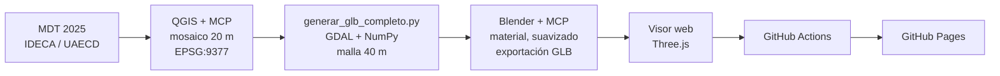

# Bogotá 3D — Modelo Digital del Terreno 2025

Mapa interactivo en 3D del Distrito Capital de Bogotá, construido a partir del **Modelo Digital del Terreno (MDT) 2025** y publicado en **GitHub Pages** mediante **GitHub Actions**. El modelo se preparó con **QGIS** y **Blender** operados por **agentes de IA a través de MCP** (Model Context Protocol).

🔗 **Visor publicado:** https://nikflorez3.github.io/Bogota_3D/

---

## Objetivo

Construir un mapa 3D interactivo de Bogotá con énfasis en el **DTM**, publicarlo en GitHub Pages con GitHub Actions y usar obligatoriamente **agentes** que operen **QGIS y Blender mediante MCP**.

| Requisito | Cómo se cumple |
|---|---|
| Mapa interactivo 3D de Bogotá | Visor web con Three.js: rotación, zoom, desplazamiento, capas y mapa base |
| Énfasis en el DTM | MDT 2025 del Distrito completo (1.027.388 vértices), con capas de elevación, pendiente y curvas de nivel |
| GitHub Pages + GitHub Actions | `.github/workflows/deploy.yml` publica el sitio en cada `push` a `main` |
| Agentes con QGIS y Blender (MCP) | OpenCode conectado a los servidores MCP de QGIS y Blender |

---

## Flujo de trabajo



### 1. Datos de origen (QGIS + MCP)
- **Fuente:** MDT 2025 de Bogotá, IDECA / UAECD.
- **Sistema de referencia:** EPSG:9377 — MAGNA-SIRGAS / Origen Nacional.
- En QGIS se trabajó el mosaico `mdt2025_bogota_20m.tif` (resolución 20 m) y los tiles derivados.
- Con el agente se diagnosticaron los 28 tiles del área: extensión, porcentaje de NoData y cobertura. Ese diagnóstico mostró que la primera versión del modelo solo cubría una franja de 5 tiles y dejaba por fuera el oriente y el sur del Distrito.

### 2. Generación de la malla
`scripts/generar_glb_completo.py` (se ejecuta con el Python de QGIS / OSGeo4W):
- Lee el mosaico del MDT y lo remuestrea a **40 m** (promedio).
- Construye **una sola malla continua**, sin cortes entre tiles.
- Excluye las celdas NoData (−9999), sin interpolar ni inventar elevaciones.
- Escribe un GLB con la convención de ejes del visor:
  - `x = E − 4.870.000` (Este)
  - `y = elevación` (m s.n.m., sin exageración vertical)
  - `z = −(N − 2.046.000)` (−Z = Norte)

```bat
python scripts\generar_glb_completo.py --src "...\mdt2025_bogota_20m.tif" --out "bogota_3d_completo.glb" --res 40
```

Resultado: 1.027.388 vértices · 2.044.738 triángulos · E 4.838.980–4.889.260 · N 1.970.300–2.092.660 · elevación 2.268–4.155 m.

### 3. Procesamiento en Blender (Blender + MCP)
El agente ejecutó en Blender, a través de la herramienta MCP `execute_blender_code`, el script `scripts/blender_exportar_glb.py`:
- Importa la malla y la nombra `MDT_2025_Bogota`.
- Aplica sombreado suave y un material Principled BSDF mate.
- Guarda el proyecto `bogota_3d.blend`.
- Exporta `bogota_3d_blender.glb` (glTF binario, +Y arriba, con normales, sin compresión Draco), **sin mover, escalar ni modificar la geometría**, para conservar la georreferenciación.

Verificación tras la exportación: el bounding box coincide exactamente con el del modelo de entrada (X −31.020 a 19.260 · elevación 2.268,3 a 4.154,6), por lo que el modelo sigue alineado con la cartografía.

En la escena de Blender también quedaron los objetos de las etapas exploratorias hechas con el agente (recortes de Cerros Orientales y zona urbana, cámara e iluminación).

### 4. Visor web
`index.html` (Three.js 0.160, sin compilación):
- **Mapa base** satelital o de calles, georreferenciado: se reproyecta de EPSG:9377 a Web Mercator con proj4js y se levanta con el relieve del entorno (Terrarium / AWS Open Data) para dar contexto alrededor del Distrito.
- **Análisis del relieve** calculado en el navegador sobre la misma malla:
  - *Elevación*: rampa de color con el rango real del modelo.
  - *Pendiente*: 5 clases (0–5°, 5–15°, 15–25°, 25–35°, > 35°), calculadas a partir de las normales de la malla.
  - *Curvas de nivel*: cada 25, 50 o 100 m, con curvas maestras cada 5 intervalos.
- Brújula que gira con la cámara, vista cenital con el norte arriba, leyenda dinámica y estadísticas del modelo.
- Diseño adaptable: en celular el panel pasa a ser una hoja inferior.

El visor carga, en este orden, `bogota_3d_blender.glb` → `bogota_3d_completo.glb` → `bogota_3d_continuo.glb` (versión inicial de 5 tiles, que se conserva como respaldo).

### 5. Publicación (GitHub Actions)
El flujo `.github/workflows/deploy.yml`:
1. Descarga el repositorio (`actions/checkout`).
2. Configura Pages (`actions/configure-pages`).
3. Empaqueta el sitio (`actions/upload-pages-artifact`, `path: .`).
4. Publica (`actions/deploy-pages`).

Se ejecuta en cada `push` a `main` y también puede lanzarse a mano (`workflow_dispatch`).

---

## Uso de agentes

Se usó **OpenCode** como agente (con sus modelos gratuitos, principalmente Nemotron 3.5 Lightning), con dos servidores MCP conectados. Como apoyo externo se usaron dos asistentes de IA: **ChatGPT** en la primera etapa (configuración, primer modelo, primera publicación) y **Claude** en la segunda (capas de análisis, modelo completo, exportación desde Blender, interfaz y documentación). El proceso completo está en la bitácora del taller.

| Servidor MCP | Uso en el proyecto |
|---|---|
| `qgis` | Consulta del proyecto y de las capas del MDT; diagnóstico de los tiles y del mosaico |
| `blender` | Inspección de la escena y ejecución de código en Blender (`get_scene_info`, `execute_blender_code`) para preparar y exportar el modelo |

Ejemplos de instrucciones dadas al agente:

> *Diagnóstico:* "Lista los 28 tiles con su extensión (E mín/máx, N mín/máx) y % de datos válidos. Revisa si la capa mdt2025_bogota_20m cubre todo el Distrito."

> *Verificación de MCP:* "Llama a las herramientas del servidor MCP blender para obtener la información de la escena actual. Luego llama a las herramientas del servidor MCP qgis para listar las capas del proyecto abierto."

> *Exportación:* "Usa la herramienta execute_blender_code del MCP blender para ejecutar este código […] y muéstrame lo que imprime."

**Cómo conectar Claude como proveedor de OpenCode:** comando `/connect` → *Anthropic* → pegar una clave de API de la consola de Claude; luego `/models` para elegir el modelo. La clave nunca se guarda en el repositorio.

**Lecciones aprendidas**
- Los agentes deben verificar lo que reportan: varias veces se dio por resuelto un problema sin comprobarlo (por ejemplo, un error 404 atribuido a la caché cuando el GLB nunca se había subido al repositorio).
- Si QGIS MCP y Blender MCP comparten el puerto 9876, uno de los dos no conecta: hay que asignar puertos distintos (Blender quedó en el 9877).
- Los modelos de lenguaje pequeños pueden no saber usar herramientas MCP aunque estén conectadas. Pasarles el código exacto y pedir una sola llamada fue lo que funcionó.

---

## Estructura del repositorio

```
├── index.html                    Visor web 3D
├── bogota_3d_blender.glb         Modelo exportado desde Blender (MCP) — el que usa el visor
├── bogota_3d_completo.glb        Malla completa generada desde el MDT
├── bogota_3d_continuo.glb        Versión inicial (5 tiles), respaldo
├── scripts/
│   ├── generar_glb_completo.py   MDT (GeoTIFF) → GLB
│   └── blender_exportar_glb.py   Procesamiento y exportación en Blender vía MCP
├── docs/capturas/                Evidencia del uso de QGIS, Blender y agentes
├── .github/workflows/deploy.yml  Publicación en GitHub Pages
└── README.md
```

Los datos originales (GeoTIFF y tiles) no se incluyen por su tamaño; se citan en la sección de fuentes.

---

## Ejecutar en local

```powershell
python -m http.server 8000
```
Abrir http://localhost:8000. El visor necesita servirse por HTTP: si se abre el `index.html` con doble clic, no carga el GLB.

---

## Limitaciones

- La malla está remuestreada a 40 m para que el visor sea fluido en el navegador; el MDT original es de 20 m.
- La pendiente se calcula a partir de las normales de la malla, por lo que es una aproximación; para análisis formales se recomienda calcularla en QGIS.
- El relieve del mapa base alrededor del Distrito proviene de SRTM (Terrarium), con menor resolución que el MDT 2025, y se dibuja 120 m por debajo para que no tape el modelo; en zonas boscosas puede asomarse en pequeñas manchas.

---

## Evidencias

Agregar en `docs/capturas/`:
- [ ] QGIS con el mosaico del MDT y el plugin MCP conectado
- [ ] Recorte de prueba de los Cerros Orientales (5 m) en QGIS
- [ ] Panel *MCP for Blender* conectado y escena con `MDT_2025_Bogota`
- [ ] Lista de servidores MCP en OpenCode (`blender` y `qgis` conectados)
- [ ] Conversación del agente ejecutando `execute_blender_code`
- [ ] Ejecuciones exitosas en la pestaña *Actions*
- [ ] Visor publicado: elevación, pendiente y curvas de nivel

---

## Fuentes y créditos

- **MDT 2025:** Infraestructura de Datos Espaciales de Bogotá (IDECA) / Unidad Administrativa Especial de Catastro Distrital (UAECD).
- **Imágenes satelitales y mapa de calles:** Esri, Maxar, Earthstar Geographics, HERE, Garmin, colaboradores de OpenStreetMap.
- **Relieve del entorno:** Terrarium elevation tiles — AWS Open Data.
- **Librerías:** [Three.js](https://threejs.org/), [proj4js](https://proj4js.org/), GDAL, NumPy.
- **Herramientas:** QGIS, Blender, OpenCode, GitHub Actions.
- **Asistentes de IA:** ChatGPT (OpenAI) y Claude (Anthropic).

**Equipo:** _(completar con los nombres de los integrantes)_
**Asignatura / programa:** _(completar)_ — Universidad Distrital Francisco José de Caldas
